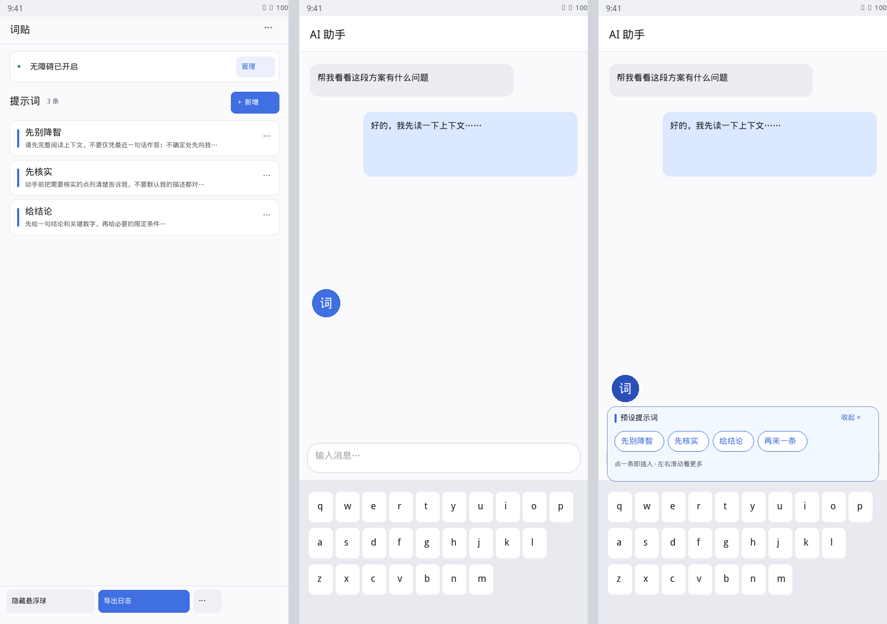

<div align="center">
  

  # 词贴 · PromptFloat

  **不换输入法，点一下把预设提示词贴进当前输入框。**

  
  
  
  
  

</div>

一个**不是输入法**的安卓小工具。平时是屏幕上一个可拖动的小球，点一下展开成一条提示词面板；
点其中一条，就把这段预设提示词插进**当前正在输入的那个输入框**——AI 对话、微信、浏览器、
笔记……任何有输入框的地方。**你的输入法一个字都不用换。**

<div align="center">
  
  <br /><sub>极简界面（v0.1.1 起）：一行状态、提示词列表、底部三个动作，无品牌头、无冗余说明</sub>
</div>

---

## 装 / 订阅

### 这个框（RSS 2.0 / Atom / JSON Feed）填这条

```
https://github.com/zjh1934/prompt-float/releases.atom
```

> ⚠️ 说清楚边界：GitHub 原生的 `releases.atom` **只有版本通知条目，不带 APK 附件**
> （feed 里没有 `<enclosure>`）。也就是说订阅后你会收到「词贴 v0.1.2 发布了」，
> 但**点进去还得自己下安装包**，它不会自动把 APK 抓下来装。
> 如果你的工具是要从 feed 里直接解析安装包，需要另做一个带 enclosure 的 feed，
> 开 issue 说一声我加。

### 自动抓包安装（Obtainium 等）填仓库地址

```
https://github.com/zjh1934/prompt-float
```

这类工具自己查 Releases 并挑 `.apk`，不需要 feed。

Releases 页面直达：

```
https://github.com/zjh1934/prompt-float/releases
```

### 安装包命名规则

**软件名 + v版本号 + `.apk`**，例如：

```
词贴-v0.1.2.apk
```

不再出现 `app-debug.apk` / `citie.apk` 这种下载目录里一堆同名、分不清谁是谁的名字。
每次出包升一个小版本，文件名跟着版本变，下载器里按名字就能认出谁是谁。
约定见 [project/版本与发布.md](project/版本与发布.md)。

### 覆盖安装：从 v0.1.1 起不用卸载

包名 `com.yuanbao.promptfloat` **永久固定，从 v0.1.0 起没变过**。
之前要卸载重装的真正原因是 CI 每次随机生成 debug 签名 —— v0.1.1 起签名也固定了。

> ⚠️ **一次例外**：`v0.1.0` 是加固定签名之前发布的旧随机签名包，
> **`v0.1.0 → v0.1.1` 这一跳仍需卸载一次**（旧密钥已随 CI runner 销毁，无法补救）。
> 从 **v0.1.1 往后**所有版本共用同一把签名，永久直接覆盖安装，提示词与授权都保留。
> 没装过 v0.1.0 的话，直接装最新版 `词贴-v0.1.2.apk` 即可。详见 [SECURITY.md](SECURITY.md)。

---

## 第一次用

装完打开 → 点「开启」→ 在系统无障碍列表里启用「词贴」→ 返回。
**这一步是 Android 系统要求**：普通 App 拿不到别的 App 的 `InputConnection`
（那是输入法专属通道），只能用无障碍服务定位输入框。Android 10 起不能 adb 代开，
13 起开启时会有醒目安全提示。

然后：在「提示词」里 ＋ 新增 → 打开任意 AI 对话点一下输入框 → 点悬浮球 → 点一条 → 文字进框。
小球可拖动贴边，球在下半屏时面板会自动翻到上方，不会被键盘吃掉。

> 边界：**只填，不发**。不替你点发送、不读输入内容、不联网、无账号、无统计、无广告。
> App 里**零 `uses-permission`**，连「显示在其他应用上层」都不用申请。

---

## 出问题了？一键导出开发者日志

主页面底部 **「导出日志」**：生成一份 **Markdown** → 写私有文件 → 复制剪贴板 → 打开分享，
可以直接整份贴给我或开 issue。里面有：

- 环境快照：版本 / 包名 / 机型 / API / 无障碍状态 / 悬浮服务是否在运行
- 错误汇总 + 完整事件时间线（`APP / SERVICE / A11Y / BALL / PANEL / INSERT / UI / DATA`）
- 关键判断：`collapse(reason=…)`、`paste=…`、`setText=…`、`focus=null` 都记着

**贴一份日志基本就能定位**。例如 `PANEL expand` 紧跟 `PANEL collapse(reason=a11y-event)`
就是 v0.1.0「点一下就收起」那个 bug；`paste=false` + `setText=false` 说明宿主输入框
拒绝了自动插入、已走剪贴板兜底。对照表见 [project/开发者日志说明.md](project/开发者日志说明.md)。

**隐私红线**：日志**不含**提示词正文、输入框文本、剪贴板内容、窗口文字，
只记事件类型、成功/失败、数量与长度。可放心公开贴。

---

## 完全开源，欢迎共创

- 协议 **MIT**，[LICENSE](LICENSE)。可自由 fork、修改、商用、再分发。
- **零第三方依赖**：`dependencies { }` 是空的，全部 Android 框架自带 API，审计很干净。
- 上游来源逐条写清：[CREDITS.md](CREDITS.md) —— 哪些是从零写的、哪些只是
  「借鉴思路并指回上游」，**没有复制任何上游项目代码**。
- 参与方式：[CONTRIBUTING.md](CONTRIBUTING.md)；更新日志 [CHANGELOG.md](CHANGELOG.md)。

特别欢迎共创：**真机兼容性实测**（沙盒没 Android SDK，这块最缺）、`{选中文本}` 占位符、
分组/多行面板、更聪明的键盘避让。

---

## 仓库结构：源码与项目文件分开，但同一个仓库

```
prompt-float/
├── app/                                  ← 软件源代码
│   ├── src/main/java/com/yuanbao/promptfloat/
│   │   ├── core/PasteAccessibilityService.kt   ★悬浮球/面板/三级插入
│   │   ├── core/DevLogger.kt                   ★开发者日志与 MD 导出
│   │   ├── ui/MainActivity.kt                  主页面（极简）
│   │   ├── data/PromptRepository.kt            提示词 CRUD / 备份
│   │   └── PromptApp.kt
│   ├── src/main/res/                          布局、drawable、无障碍配置
│   └── debug.keystore                         固定开发签名（公开）
├── docs/preview/                         ← 用代码画的 UI 预览与 LOGO
├── project/                              ← 项目文件，不是源码，但同仓库
│   ├── 需求与决策.md                        防断片：需求原话、纠正记录、技术决策
│   ├── 版本与发布.md                        包名/签名固定、小版本约定、发布记录
│   ├── 开发者日志说明.md                    日志字段、隐私边界、定位对照表
│   └── 待办与已知限制.md
├── .github/workflows/build.yml           CI：编译 + 自动发 Release 挂 APK
└── README / CREDITS / CONTRIBUTING / CHANGELOG / SECURITY / LICENSE
```

> 改功能动 `app/`，改「我们为什么这么做」动 `project/`。两者一起版本化、一起追溯。

| 项 | 值 |
|---|---|
| 语言 | Kotlin，原生 View / XML，无 Compose |
| minSdk / targetSdk / compileSdk | 26 / 34 / 34 |
| 构建 | AGP 8.5.2 · Kotlin 1.9.24 · Gradle 8.7 · JDK 17 |
| 依赖 / 权限声明 | 无 / 无（仅需手动开启无障碍服务） |
| 包名 | `com.yuanbao.promptfloat`（永久固定） |

---

## 编译

```bash
git clone https://github.com/zjh1934/prompt-float.git
cd prompt-float
gradle wrapper --gradle-version 8.7 --distribution-type bin
./gradlew :app:assembleDebug
# Gradle 原生产物：app/build/outputs/apk/debug/app-debug.apk
# 发布到 Releases 时 CI 会改名成：词贴-v0.1.2.apk（软件名 + v版本号）
```

Android Studio（Giraffe+）直接打开根目录也可以。CI 用内置 `GITHUB_TOKEN` 即可，
**不需要个人 PAT**；若确需 PAT 请放 Settings → Secrets，不要写进任何文件。

---

## 已知限制

- 自绘输入框、密码框、部分 WebView 可能拒绝两个插入动作 → 已兜底到剪贴板 + Toast。
- 悬浮球也会浮在自家设置页上；键盘避让目前是静态高度估算。
- 提示词目前是纯文本，导入导出走剪贴板 + 私有文件（日志已支持 SAF 另存）。
- 未做云端同步（刻意不做，保持完全离线）。

详细决策记录见 [project/需求与决策.md](project/需求与决策.md)。
