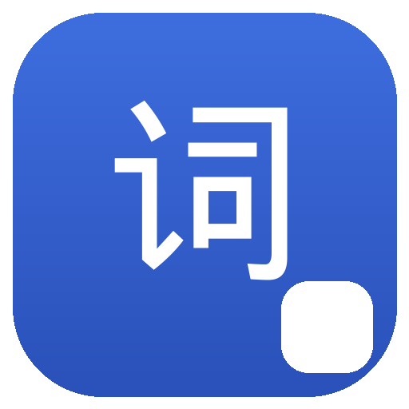
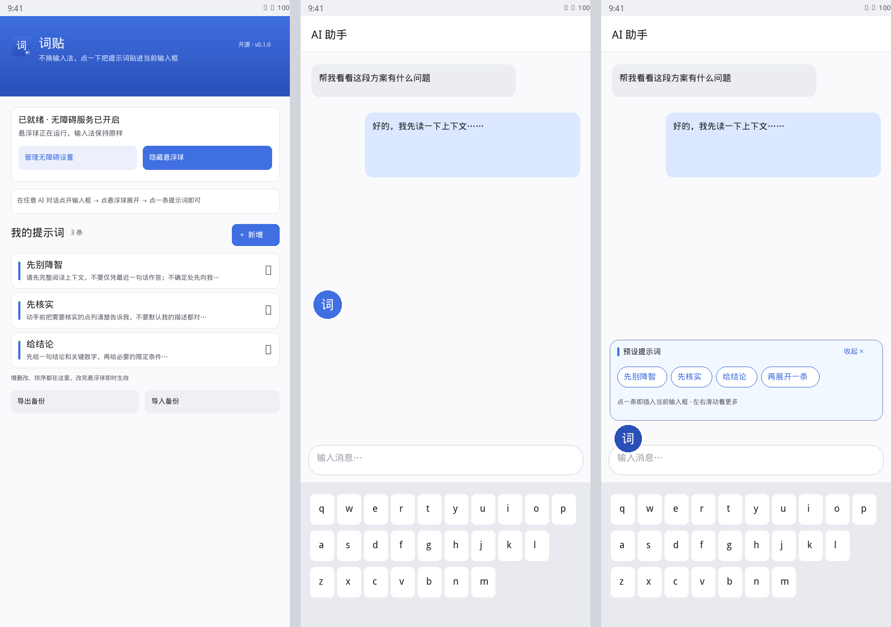

<div align="center">
  

  # 词贴 · PromptFloat

  **不换输入法，点一下把预设提示词贴进当前输入框。**

  
  
  
  

</div>

一个**不是输入法**的安卓小工具。平时是屏幕上一个可拖动的小球，点一下展开成一条提示词面板；
点其中一条，就把这段预设提示词插进**当前正在输入的那个输入框**——AI 对话、微信、浏览器、
笔记……任何有输入框的地方。**你的输入法一个字都不用换。**

提示词的新增 / 编辑 / 删除 / 排序 / 备份，全在主页面里做，改完悬浮球即时生效。

<div align="center">
  
  <br /><sub>左：主页面　中：悬浮球收起态　右：球被拖到下半屏时面板自动翻到上方</sub>
</div>

---

## 先说清楚一件必须知道的事

「不跟输入法抢」能做到，但有个绕不开的 Android 事实：

> 普通 App **拿不到别的 App 的 `InputConnection`**，那是输入法（`InputMethodService`）专属的通道。
> 想在别人的输入框里写字，唯一正经路子是 **无障碍服务（AccessibilityService）**。

所以：**装完不能直接用，需要你去「设置 → 无障碍」里手动把「词贴」打开一次。**
这是系统要求，不是这个 App 想要权限。Android 10 起不能再用 adb 直接开，Android 13 起开启时
会有更醒目的安全提示弹窗。

但比预想的省事：悬浮球直接画在无障碍服务的 `TYPE_ACCESSIBILITY_OVERLAY` 层上，
**连「显示在其他应用上层」(`SYSTEM_ALERT_WINDOW`) 都不用申请**，`AndroidManifest.xml` 里
零 `uses-permission`。你只需要开一个开关，而且这个 App 不联网、不读你输入的内容、不上传任何东西。

三个技术要点：

- 所有浮窗都带 `FLAG_NOT_FOCUSABLE`。一旦浮窗抢焦点，输入框失焦、键盘收起，
  `findFocus(FOCUS_INPUT)` 立刻返回 null，悬浮球等于把自己弄没了——这个标志就是
  「不跟输入法抢」的技术保证。
- 定位当前输入位置用 `findFocus(AccessibilityNodeInfo.FOCUS_INPUT)`，
  注意别用 `FOCUS_ACCESSIBILITY`（那是 TalkBack 的绿框，不是光标）。
- 插入顺序 **PASTE → SET_TEXT → 剪贴板**：`ACTION_PASTE` 尊重光标、不覆盖你已经打的一半草稿；
  `ACTION_SET_TEXT` 会整体替换，所以只能当兜底并且要按选区拼接。密码框 / Flutter /
  部分自绘输入框两个动作都可能拒绝，此时提示词留在剪贴板并提示你长按粘贴。

> 边界：**只填，不发**。不替你点发送、不读输入内容、不联网、无账号、无统计、无广告。

---

## 安装与订阅

### 手动装

去 [Releases 页面](https://github.com/zjh1934/prompt-float/releases) 下载最新的 `.apk`，
允许「安装未知来源」后安装，再按主页面提示开启无障碍服务。

### 下载工具订阅（Obtainium 等）

⚠️ 这里要纠正一个常见误解：**GitHub Releases 页面本身没有一个「订阅链接」能让下载工具直接订阅安装包**。
两类链接用途不同，别加错：

**① 给下载工具（Obtainium / AppVerifier / FFUpdater 等）填的是仓库地址**，
工具自己会去查这个仓库的 Releases 并挑 `.apk`：

```
https://github.com/zjh1934/prompt-float
```

**② 想订阅「出新版本」的通知，用 Releases 的 Atom feed**（RSS 阅读器 / 通知机器人用，
它只告诉你有新版本，**不提供 APK 下载**）：

```
https://github.com/zjh1934/prompt-float/releases.atom
```

Releases 页面直达：

```
https://github.com/zjh1934/prompt-float/releases
```

> 要让下载工具能正常识别，每个 Release 里必须挂 `.apk` 资产（本项目 CI 已自动处理），
> 且版本号走 `v0.1.0` 这种 tag。见 [.github/workflows](.github/workflows)。

---

## 用起来是这样

1. 装 APK → 打开「词贴」→ 点「去开启无障碍」→ 在系统列表里启用「词贴」→ 返回。
2. 在「我的提示词」里 ＋ 新增几条（标题 + 全文），用 `⋯` 菜单上移 / 下移 / 编辑 / 删除。
3. 打开任意 AI 对话，点一下输入框让键盘弹出来。
4. 点小悬浮球 → 展开一排提示词 → 点一条 → 文字进输入框，输入法纹丝不动。
5. 小球可拖动、松手贴边；再点球（或「收起 ✕」）收起面板。
   球被拖到屏幕下半部时，面板会自动翻到球**上方**，不会被键盘吃掉。

---

## 完全开源，欢迎共创

- 协议：**MIT**，[LICENSE](LICENSE)。可自由 fork、修改、商用、再分发。
- 零第三方依赖：`dependencies { }` 是空的，全部用 Android 框架自带 API，审计起来很干净。
- 上游来源逐条写清：[CREDITS.md](CREDITS.md) —— 哪些是本项目从零写的、
  哪些只是「借鉴思路并指回上游」，都在表里。**没有复制任何上游项目的代码。**
- 参与方式：[CONTRIBUTING.md](CONTRIBUTING.md)，更新日志见 [CHANGELOG.md](CHANGELOG.md)。

特别欢迎共创：更多 App 的输入框兼容性实测、`{选中文本}` 变量占位符、分组/多行面板、
SAF 文件导入导出、更聪明的键盘避让。

---

## 工程结构

```
prompt-float/
├── app/src/main/java/com/yuanbao/promptfloat/
│   ├── PromptApp.kt                       Application，持有仓库单例
│   ├── data/PromptRepository.kt           提示词 CRUD / 排序 / JSON 备份
│   ├── core/PasteAccessibilityService.kt  ★核心：无障碍 + 悬浮球 + 面板 + 三级插入
│   └── ui/MainActivity.kt                 权限状态 + 提示词管理 + 导入导出
├── app/src/main/res/                    布局、drawable、无障碍配置
├── docs/
│   ├── 需求与决策.md                     防断片：需求原话、技术决策、当前状态
│   └── preview/                         LOGO 与 UI 预览图（用代码绘制）
├── CREDITS.md / CONTRIBUTING.md / CHANGELOG.md
└── .github/workflows/build.yml           CI：编译 + 自动发 Release 挂 APK
```

| 项 | 值 |
|---|---|
| 语言 | Kotlin，原生 View / XML，无 Compose |
| minSdk / targetSdk / compileSdk | 26 / 34 / 34 |
| 构建 | AGP 8.5.2 · Kotlin 1.9.24 · Gradle 8.7 · JDK 17 |
| 依赖 | 无 |
| 权限声明 | 无（仅需用户手动开启无障碍服务） |

---

## 编译

```bash
git clone https://github.com/zjh1934/prompt-float.git
cd prompt-float
gradle wrapper --gradle-version 8.7 --distribution-type bin
./gradlew :app:assembleDebug
# 产物：app/build/outputs/apk/debug/app-debug.apk
```

Android Studio（Giraffe+）直接打开根目录也可以，会自动补齐 Gradle Wrapper。
CI 用 GitHub Actions 内置的 `GITHUB_TOKEN` 即可，**不需要个人 PAT**；
若确需 PAT，请放仓库 Settings → Secrets，不要写进任何文件。

---

## 已知限制 / 下一步

- 自绘输入框、密码框、部分 WebView 可能两个动作都拒绝 → 已兜底到剪贴板 + Toast。
- 悬浮球目前也浮在自家设置页上；后续可加「本 App 前台时隐藏」过滤。
- 提示词目前是纯文本；后面可加 `{选中文本}` / 日期等变量占位符。
- 导入导出目前走剪贴板 + 应用私有文件；可换成系统文件选择器（SAF）。
- 未做云端同步（刻意不做，保持完全离线）。

详细决策记录见 [docs/需求与决策.md](docs/需求与决策.md)。
